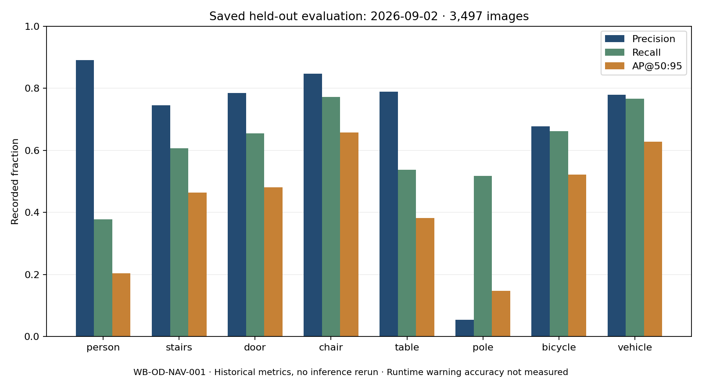

# WalkBuddy evaluation engineering audit

Audit date: 15 October 2026 (Australia/Sydney). Interview: 16 October 2026.
Starting commit: `fc55253`; starting branch: `docs/final-ml-production-handover`.
Work branch: `codex/a2i2-evaluation-evidence`. Existing modified handover documents,
untracked integrated-verification evidence, presentation build and package lock
were preserved. See [validation](VALIDATION.md) for executed checks.

## Method and implementation priorities

Inventory tracked source, ignored local model assets, dataset directories,
notebooks, five experiment CSV/config pairs, registry/deployment metadata,
evaluation packages, backend routes, frontend callers, tests and CI. Read
`dataset_analyze.py` and existing experiment narratives before choosing changes.
Trace claims to machine-readable artifacts; compare SHA-256 and taxonomy before
using measurements. Exercise real pure functions with explicitly synthetic
inputs; distinguish syntax checks, model accuracy and system behavior.

Source text fingerprints normalize CRLF to LF to match Git across Windows/Linux
checkouts. The report declares this convention. Model artifact SHA-256 values
continue to use exact bytes. The evaluator summary's exact artifact checksum is
documented separately below, and its bytes remain unchanged.

This is a source/artifact audit with targeted executable checks, not a complete
device acceptance exercise or a fresh labelled model evaluation. No real dataset
was supplied. External Teams/SharePoint storage was not queried.

| Priority | Implemented scope | Reason |
| --- | --- | --- |
| 1 | Extend the existing candidate inspector; preserve the legacy analyzer | Avoid replacing established tools; close silent empty-split/orphan/identity failures and expose coverage |
| 2 | Summarize existing evaluation with identity checks, source digests, CSV and an optional chart | Make interview claims reproducible without inference or retraining |
| 3 | Characterize warning thresholds and route failures with focused tests | Detection metrics alone cannot establish warning reliability |
| 4 | Brief, limitations, reproduction commands and CI selection | Leave an explainable, reviewable result the team can maintain |

## Repository inventory and status

| Surface | Observed implementation | Evidence boundary / gap |
| --- | --- | --- |
| `ML_side/data/dataset_analyze.py` | Historical eight-class console analyzer; hardcoded train/val paths and names; runs at import | Missing directories produce zero counts without failing; malformed rows are silently skipped; no geometry/leakage checking |
| `ML_side/tools/inspect_candidate_dataset.py` | Existing read-only YOLO parsing, pair reports, SHA-256 duplicate checks, optional explicit group leakage and reviewed taxonomy mappings | Extended here with split distributions/CSV/coverage, `nc` and ID checks, empty-split failures, ambiguous paired stems and invalid orphan rows |
| `ML_side/data_pipeline/` | Checkpointed Python pipeline, provenance, exact/perceptual deduplication, grouping, annotation review, split/representativeness/balance and release stages | Implemented code and fixture tests; no new real pipeline run or release-quality conclusion here |
| `ML_side/notebooks/` | Twelve historical notebooks; some contain outputs, others prototypes without outputs | Preserved; notebook outputs are not current deployment evidence |
| `ML_side/datasets/`, `ML_side/data/` | Manifest/schema/example/config metadata and placeholder directories | No actual image/label train, validation or test split in this checkout; registry points to external controlled release `walkbuddy-navigation-v5` |
| `ML_side/config/dataset_v2/` | Navigation taxonomy plus historical indoor configuration | Paths are placeholders or historical layouts; not evidence that data exists locally |
| `ML_side/training/` | Wrapper validates release lineage, seed/settings and workspace checksums; separates immutable release from mutable trainer workspace | Training configuration is available; no full candidate training `results.csv` here; no training performed |
| `ML_side/experiments/cohort-1/` | Five real historical CSV logs and `args.yaml` files | Final rows reproducible; missing weight/dataset linkage prevents attributing these results to current production |
| `ML_side/evaluation/` | Labelled metrics, matching, latency, geometry and prediction tooling, synthetic fixtures and corrected held-out summary | Corrected summary records 3,497 test images and artifact SHA; raw predictions, class support and evaluator dataset content digest absent |
| `ML_side/scenario_regression/` | Offline canonical class-presence regression with controlled fixtures | Class presence is different from instance IoU matching, navigation geometry or user safety |
| `ML_side/model_registry/`, `deployment/` | Versioned identity, explicit production approval, manifest, validation and readiness tooling | Registry status is production; offline readiness consistency is different from live model identity or successful phone operation |
| `ML_side/models/best.pt` (ignored) | Local file SHA matches registry and corrected summary; 5,364,741 bytes | Byte identity checked; no deserialization, fresh inference or live endpoint checked in this task |
| `ML_side/testing_pipeline/` | Historical HTTP/image/video harness, presence scoring and saved failure logs | Case uses retired `/detect`, expects `events`/legacy labels; current `/vision` returns `detections`. One saved pass is not current accuracy or a coherent time series |
| Backend vision/OCR/depth/LLM | FastAPI adapters, runtime identity, direction/motion, OCR and deterministic safety override; relative depth is explicitly unitless | Optional dependencies and real runtime are separate; tests use controlled adapters/route stubs. LLM factual correctness was not evaluated |
| Frontend/mobile | Current client calls `/vision`, `/ocr`, `/chat`; phone speaks returned guidance; WebSocket flow exists | Root README contains historical mismatch narrative; no phone was connected or UI exercised in this task |
| Predictive path | Separate sensor CSV, serialized model, train/eval/router code | Not part of detector or warning evaluation; no accuracy claim or model loading here |
| `.github/workflows/ml-safety.yml` | Existing model-free safety and release-readiness gates | Inspector and interview evidence tests now included; hosted CI not run from this local task |

## Recorded measurements and attribution

The source is the [corrected evaluator summary](../../ML_side/evaluation/candidates/navigation-mvp-full-candidate-56c445bb8c85-heldout-test-corrected/summary.json),
dated **2 September 2026**, not a measurement made for this interview.
Its SHA-256 is `16b05cbdf0ca11116f27ce196c13697ec13018004a4cfd69a6a773212b42b8da`.
It identifies weights with SHA-256
`3cbdadd14b018573803d31f3c7bd5683bf7abd19649aff6da7c1f1ea1d78cc5f`;
that matches the current registry and local `best.pt` bytes.

| Recorded aggregate | Fraction |
| --- | ---: |
| Precision | 0.696031 |
| Recall | 0.612151 |
| mAP@50 | 0.668523 |
| mAP@50:95 | 0.435670 |
| Test images | 3,497 |

Precision describes how often predicted detections are correct; recall describes
how much annotated target content is recovered, under the evaluator's matching
and confidence conventions. AP summarizes a precision/recall curve at an IoU
threshold; mAP averages class AP. IoU measures predicted/labelled box overlap.
mAP@50:95 averages stricter IoU thresholds from 0.50 through 0.95 in steps of
0.05. These are detection measures, not percentages of journeys made safe.

The new CSV derives per-class `2PR/(P+R)` from recorded P/R and labels that
derivation explicitly. Aggregate P/R do **not** recover mean per-class F1 or
micro F1. The tool leaves recorded aggregate F1 unavailable and separately
derives the unweighted mean of the supplied per-class F1 values. It cannot compute
confidence intervals, TP/FP/FN, support-weighted results or warning accuracy at
the runtime confidence threshold from this summary.

The evaluation records an Ultralytics default confidence sweep and no runtime
operating-point inference. Training configuration records seed 42 and
`ML_side/models/yolo26n.pt` as initial weights; this is a configuration fact, not
proof that the saved evaluator used that seed. YOLOv8n is the historical cohort-1
selection. Its final CSV mAP@50 is **0.85731**; there is no corresponding artifact
SHA in that log. Comparing 0.85731 against the current 0.668523 as a regression
would ignore different taxonomies and unknown dataset/weight lineage.

## Most meaningful failures and expected versus observed behavior

The route tests use real route functions with adjacent services stubbed. They
measure deterministic behavior given synthetic inputs, not image-model accuracy.
Passing characterization tests confirm the gap still exists; they do not endorse
it as a desired safety policy.

| Finding | Expected evaluation requirement | Observed evidence | Recommendation |
| --- | --- | --- | --- |
| Pole precision weakness | Assess false alarms as well as misses for hazardous classes | Recorded pole P=0.054818, R=0.518405, AP50=0.175503, AP50:95=0.147607; derived F1=0.099151 | Inspect validation-only false-positive/false-negative examples, source mix and geometry; do not tune on the held-out test set or claim a cause from aggregates |
| Threshold seam | Measure warning reliability at deployed operating points | Detector uses `conf=0.25`; pure gate warns at >=0.5. Synthetic stairs at 0.499 has no stop override; at 0.5 it does | Evaluate detection-to-warning outcomes on labelled scenarios, including near-threshold examples |
| Unsupported stationary hazard | Explicitly acknowledge what model/policy cannot cover | `pothole` is outside the canonical eight classes and a synthetic stationary event has no stop override | Define unknown/unsupported-hazard handling and collect reviewed coverage; no claim that current weights detect potholes |
| Empty/filtered output wording | Insufficient detections must express uncertainty | Real guidance processing plus `_guidance_payload` returns `('Path clear', 'CLEAR')` for empty output and synthetic stairs at confidence 0.25/0.299; message processing filters below 0.3 | Replace overconfident wording through team review; test empty, obscured, low-confidence and failed frames separately |
| Motion loss across chat boundary | Preserve motion fields used by hazard rules | Approaching `unknown` warns at the pure gate; normalization strips `approaching`, then no warning occurs | Preserve validated motion context across `/chat`; add route-level parity cases |
| Scene question precedes stop override | Hazard context should remain explicit in safety-related replies | Synthetic “Is it safe to move ahead?” + stairs yields “I can see stairs ahead.” | Review branch ordering and combine scene description with deterministic hazard wording |
| Audit silent failures | Invalid labels and unusable splits must be visible | Original inspector skipped malformed orphan rows and allowed an empty declared split; same stem in different image formats reused one label | Fixed in the inspector; fixture tests prove failure reporting, not defects in unavailable real data |
| Historical test semantics | Keep contract and metric meanings consistent | Old case expects `chair` while saved response has `office-chair`; scorer treats unspecified detections as FP without complete ground truth | Retire/update through a separate team task; use current canonical aliases and allowed classes; do not call presence counts instance detection accuracy |

Existing depth handling correctly keeps `distance_m: null` when only unitless
`relative_depth` is known. Canonical class tests cover all eight classes and the
`office-chair` alias; no current alias mismatch was found there. The existing
model card already discloses pole weakness. Pending pole-data investigations are
not treated as verified findings.

## Limits and next steps

Real split counts, class imbalance, duplicates, sequence leakage, annotation
quality and source representation remain **unmeasured** here. No real dataset
was available in the checkout. SHA equality proves artifact identity, not
correctness of labels or reported metrics. No current backend, physical device,
OCR accuracy, LLM response quality, accessibility study or agent evaluation was
run. Existing runtime-soak/benchmark reports remain historical evidence.

With controlled data access, run the inspector against train/validation/test with
an explicit group map, then use validation-only slices for failure diagnosis.
Track scene/source/session IDs, geometry, conditions, annotation adjudication,
operating points, raw outcomes and environment versions. Reserve held-out data
for a predeclared final evaluation. Review the four route/policy gaps with the
backend and accessibility owners before changing product behavior.

All new claims are reproduced by commands in the
[interview brief](A2I2_EVALUATION_BRIEF.md); executed checks and environmental
limitations are in [VALIDATION.md](VALIDATION.md).
